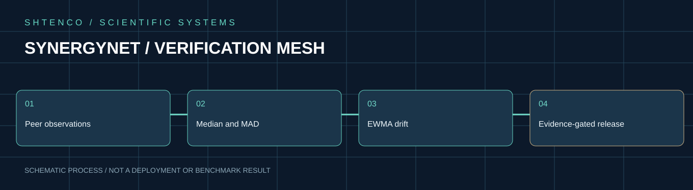
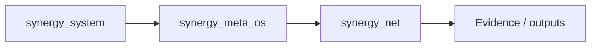
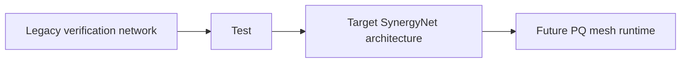

<!-- RESEARCH-V2-2026:START -->
<div align="center">


**[Глубокое научно-техническое досье — алгоритмы, формулы и проверяемые исследования](docs/SCIENTIFIC_DOSSIER_V2_2026.md)**
</div>

<!-- RESEARCH-V2-2026:END -->

# SYNERGYNET

**Post-quantum P2P mesh and content-transport layer for SYNERGY nodes.**

Architecture root: `Shtenco/synergy_system`  
Compression source: `Shtenco/ai_compress`  
Target node orchestrator: `Shtenco/synergy_meta_os`  
Target host: `Shtenco/turbo_linux`

## Role

SynergyNet is a planned network overlay in which a node can act as client, server, router, relay and content cache.

A SYNERGY blockchain/financial/autopilot node may also run SynergyNet, but **network participation alone never grants financial, validator or treasury authority**.

## Target architecture

```text
Application Object / Stream / Packet
        ↓
Canonical Framing
        ↓
Content-Defined Chunking
        ↓
Content Hash
        ↓
Local Deduplication
        ↓
Network-Wide Dedup / Cache Lookup
        ↓
Compression Profile Selection
        ↓
Post-Quantum Authenticated Session Protection
        ↓
Multipath Route Selection
        ↓
P2P Relay / Store-and-Forward / Direct Path
        ↓
Receiver Cache
        ↓
Decompression / Reconstruction
        ↓
Hash + Integrity Verification
```

## Main research hypothesis

Repeated content across users/nodes can reduce network traffic when the network exchanges content identities/chunks instead of retransmitting identical bytes, especially when combined with domain-appropriate lossless compression from `ai_compress`.

This is a hypothesis to benchmark, not a performance claim.

## Node capabilities

Possible node profiles:

```text
CLIENT
RELAY
CACHE
GATEWAY
BLOCKCHAIN_PEER
NEXUS_COMPUTE
METAPAY_EDGE
FULL_SYNERGY_NODE
```

Roles must be explicit and separately authorized.

## Content-addressed transport

Recommended object model:

```text
Object Manifest
  ├─ object hash
  ├─ ordered chunk hashes
  ├─ original size
  ├─ codec/profile id
  ├─ compression metadata
  ├─ optional erasure coding metadata
  └─ integrity/signature metadata
```

A node that already possesses a chunk should not download the same chunk again merely because another logical object references it.

## Deduplication layers

```text
L0 process-local cache
L1 node-local content store
L2 trusted/LAN peer cache
L3 wider mesh distributed cache / DHT-like discovery
```

Privacy policy must constrain what content hashes or cache-presence information can be exposed to peers.

## Compression integration

`ai_compress` is the technology source for validated codecs and archive research.

SynergyNet needs a network-specific codec policy because best archive ratio is not necessarily best network performance.

Selection should optimize a cost function such as:

```text
network_cost =
    bytes_on_wire
  + encode_cpu_cost
  + decode_cpu_cost
  + latency_penalty
  + memory_penalty
  + cache_amplification
```

Possible profiles may use raw/no compression, established external codecs and validated SYNERGY codecs. Every selected profile must preserve exact reconstruction where the transport contract is lossless.

## Post-quantum security target

The project targets post-quantum-ready identity/session security, but must use reviewable standard primitives and explicit algorithm/version negotiation.

Security layers should distinguish:

- node identity;
- session key establishment;
- packet/message authentication;
- content integrity;
- blockchain keys;
- financial/payment keys.

A network identity key must not automatically become a treasury or validator key.

## Routing target

Research areas:

- direct peer discovery;
- relay routing;
- multipath transport;
- latency/loss-aware routing;
- store-and-forward for intermittent nodes;
- congestion control;
- NAT traversal;
- local-first routing;
- optional erasure coding;
- content-aware route/cache selection.

## Performance constitution

The network must not call itself “the fastest Internet” without matched evidence.

Required benchmark dimensions:

```text
latency
throughput
goodput
bytes transmitted
compression ratio
encode/decode CPU
memory
packet loss tolerance
recovery time
cache hit rate
dedup savings
first-byte latency
energy/resource cost where measurable
```

Compare against explicit baselines such as conventional TCP/HTTP, QUIC/HTTP3 and a selected P2P/content-distribution baseline under the same hardware/network impairment profile.

## Privacy and abuse resistance

A global dedup/cache network can leak information if designed naively. Research must consider:

- private/salted content addressing where needed;
- encrypted content and access control;
- cache-probing resistance;
- peer reputation / abuse controls;
- bandwidth/resource quotas;
- spam/Sybil resistance;
- metadata minimization.

## Initial repository structure

```text
synergynet/
  protocol/
  identity/
  session/
  framing/
  chunking/
  content_store/
  dedup/
  compression/
  routing/
  discovery/
  transport/
  cache/
  simulation/
  benchmarks/
  evidence/
  tests/
```

## First milestone

Build a local 3–10 node testbed that can:

1. establish authenticated sessions;
2. transfer a content-addressed object;
3. deduplicate repeated chunks across transfers;
4. negotiate a compression profile;
5. reconstruct bytes exactly;
6. switch between direct and relay paths;
7. survive controlled loss/reordering;
8. export raw benchmark evidence against a conventional baseline.

Only after this should larger “new Internet” performance claims be evaluated.

## Principle

**SynergyNet moves and deduplicates verified information. It does not create economic or consensus authority merely because it transports the bytes.**

---

<!-- NEXUS-REPORTS-BENCHMARKS:START -->
## NEXUS — отчёты и бенчмарки

> Канонический реестр: [NEXUS_REPORTS_BENCHMARKS_REGISTRY.md](https://github.com/Shtenco/synergy_gllm_nexus/blob/main/NEXUS_REPORTS_BENCHMARKS_REGISTRY.md)  
> Канонический research runtime: [Shtenco/synergy_gllm_nexus](https://github.com/Shtenco/synergy_gllm_nexus)  
> Активная исследовательская ветка: [unified-v3-generalization-first](https://github.com/Shtenco/synergy_gllm_nexus/tree/unified-v3-generalization-first)  
> Последнее синхронное обновление README: **2026-09-19**

### Ключевые подтверждённые результаты

| Линия / benchmark | Результат | Что проверялось |
|---|---:|---|
| **R7-L D192 / Blind-18** | **3072/3072 = 100%**, 48/48 held-out operators | настоящий few-shot unseen-operator transfer, без Authority и без inference weight updates |
| **R7.2 / Blind-20** | historical **320/320 = 100% harness-assisted**; autonomous exact **254/320 = 79.375%** | final head in old harness used benchmark-side true intent; deployable path uses predicted intent |
| **R7.6 / Blind-23** | **56/58 = 96.55%** | post-freeze semantic/paraphrase transfer |
| **R7.10 / Blind-27** | **150/160 = 93.75%** | fresh 8-domain frozen blind |
| **R7.18 / Blind-31** | **156/200 = 78%** | broad post-freeze OOD |
| **R7.44 / Blind-62** | **3066/3200 = 95.81%** | context/state composite |
| **R7.44.1 / Blind-63** | **2400/2400 = 100%** | context contract |
| **R7.44.2 / Blind-64** | **2400/2400 = 100%** | context contract |
| **R7.44.3 / Blind-65** | **2400/2400 = 100%** | context contract; Dialogue-65 25/25 |
| **Ω-1.5R2 / Blind-4** | strict triple **50.37% / 66.63%** | role/subject/object/graph transfer |
| **Unified v2 UB1** | **904/970 = 93.1959%** | integration benchmark; exposed-development, не pristine blind |
| **Unified v2 UB2** | **2104/2140 = 98.3178%** | regression benchmark; regex baseline повторяет score, paraphrase stress ≈26.17% |
| **v3 P0.1 META-OOS C** | **99.44%** | synthetic OOS внутри одной high-level generator family |
| **HARD-OOS D** | **21.91%**, representation failure **100%** | zero-shot перенос на новый AST/rule-language basis; benchmark уже consumed |
| **v3-MoE P1** | useful Top-K recall **99.62%**, negative transfer **0.48%**, strict routing **98.80%** | learned MoE routing на mixed synthetic META-OOS |
| **NEXUS-MOE-B1** | learned **94.44%**, best single **33.33%**, naive **59.17%**, oracle **95.83%** | frozen one-shot на 7 exact-runnable historical experts; learned negative transfer **1.45%** |
| **FTX1** | **BLIND sealed / unopened** | главный one-shot end-to-end far-transfer benchmark |

### Полный набор канонических отчётов

1. [2026-09-15 — Ω-1.3 local 100K](https://github.com/Shtenco/synergy_gllm_nexus/blob/unified-v3-generalization-first/docs/results/2026-09-15-omega13-local-100k.md)
2. [2026-09-15 — Ω-1.4 local 100K](https://github.com/Shtenco/synergy_gllm_nexus/blob/unified-v3-generalization-first/docs/results/2026-09-15-omega14-local-100k.md)
3. [2026-09-16 — NEXUS cross-generation audit](https://github.com/Shtenco/synergy_gllm_nexus/blob/unified-v3-generalization-first/docs/results/2026-09-16-nexus-cross-generation-audit.md)
4. [2026-09-16 — Full 78-generation evidence ledger](https://github.com/Shtenco/synergy_gllm_nexus/blob/unified-v3-generalization-first/docs/results/2026-09-16-nexus-full-78-ledger.md)
5. [2026-09-16 — Ω-1.5R2 Blind-4 one-shot JSON](https://github.com/Shtenco/synergy_gllm_nexus/blob/unified-v3-generalization-first/docs/results/2026-09-16-omega15r2-blind4-one-shot.json)
6. [2026-09-16 — Ω-1.6 research-agent landscape](https://github.com/Shtenco/synergy_gllm_nexus/blob/unified-v3-generalization-first/docs/results/2026-09-16-omega16-research-agent-landscape.md)
7. [2026-09-16 — Unified NEXUS rebuild v1](https://github.com/Shtenco/synergy_gllm_nexus/blob/unified-v3-generalization-first/docs/results/2026-09-16-unified-nexus-rebuild-v1.md)
8. [2026-09-17 — FTX1 freeze report](https://github.com/Shtenco/synergy_gllm_nexus/blob/unified-v3-generalization-first/docs/results/2026-09-17-nexus-ftx1-freeze-report.md)
9. [2026-09-17 — Unified v3 P0 report](https://github.com/Shtenco/synergy_gllm_nexus/blob/unified-v3-generalization-first/docs/results/2026-09-17-nexus-unified-v3-p0-report.md)
10. [2026-09-17 — Unified v2 RC1 final](https://github.com/Shtenco/synergy_gllm_nexus/blob/unified-v3-generalization-first/docs/results/2026-09-17-unified-v2-rc1-final.md)
11. [2026-09-18 — Unified v3 P0.1 training report](https://github.com/Shtenco/synergy_gllm_nexus/blob/unified-v3-generalization-first/docs/results/2026-09-18-nexus-unified-v3-p01-training-report.md)
12. [2026-09-18 — HARD-OOS D frozen zero-shot report](https://github.com/Shtenco/synergy_gllm_nexus/blob/unified-v3-generalization-first/docs/results/2026-09-18-nexus-v3-hard-oos-d-zero-shot-report.md)
13. [2026-09-18 — v3-MoE P1 training report](https://github.com/Shtenco/synergy_gllm_nexus/blob/unified-v3-generalization-first/docs/results/2026-09-18-nexus-v3-moe-p1-training-report.md)
14. [2026-09-19 — Artifact-Complete audit + NEXUS-MOE-B1](https://github.com/Shtenco/synergy_gllm_nexus/blob/unified-v3-generalization-first/docs/results/2026-09-19-nexus-v3-moe-artifact-complete-b1-report.md)
15. [Unified v2 P0 report](https://github.com/Shtenco/synergy_gllm_nexus/blob/unified-v3-generalization-first/docs/results/UNIFIED_V2_P0_REPORT.md)
16. [Unified v2 P0 / UB1 summary JSON](https://github.com/Shtenco/synergy_gllm_nexus/blob/unified-v3-generalization-first/docs/results/UNIFIED_V2_P0_UB1_SUMMARY.json)

### Frozen benchmark suites и manifests

**CROSSGEN-1**
- [Freeze manifest](https://github.com/Shtenco/synergy_gllm_nexus/blob/unified-v3-generalization-first/benchmarks/crossgen1/CROSSGEN1_FREEZE_MANIFEST.json)
- [Schema](https://github.com/Shtenco/synergy_gllm_nexus/blob/unified-v3-generalization-first/benchmarks/crossgen1/schema.py)

**Ω / Unified frozen**
- [Ω-1.4 Blind-2 freeze](https://github.com/Shtenco/synergy_gllm_nexus/blob/unified-v3-generalization-first/benchmarks/frozen/OMEGA14_BLIND2_FREEZE_MANIFEST.json)
- [Ω-1.5 Blind-3 freeze](https://github.com/Shtenco/synergy_gllm_nexus/blob/unified-v3-generalization-first/benchmarks/frozen/OMEGA15_BLIND3_FREEZE_MANIFEST.json)
- [Ω-1.5R2 preblind final freeze](https://github.com/Shtenco/synergy_gllm_nexus/blob/unified-v3-generalization-first/benchmarks/frozen/OMEGA15R2_PREBLIND_FINAL_FREEZE.json)
- [Ω-1.5R2 Blind-4 freeze](https://github.com/Shtenco/synergy_gllm_nexus/blob/unified-v3-generalization-first/benchmarks/frozen/OMEGA15R2_BLIND4_FREEZE_MANIFEST.json)
- [Unified rebuild v1 freeze](https://github.com/Shtenco/synergy_gllm_nexus/blob/unified-v3-generalization-first/benchmarks/frozen/UNIFIED_REBUILD_V1_FREEZE_MANIFEST.json)
- [Unified integration benchmark freeze](https://github.com/Shtenco/synergy_gllm_nexus/blob/unified-v3-generalization-first/benchmarks/frozen/UNIFIED_REBUILD_V1_INTEGRATION_BENCH_FREEZE.json)
- [Unified preblind checkpoint freeze](https://github.com/Shtenco/synergy_gllm_nexus/blob/unified-v3-generalization-first/benchmarks/frozen/UNIFIED_REBUILD_V1_PREBLIND_CHECKPOINT_FREEZE.json)

**Unified v2 UB2**
- [UB2 README](https://github.com/Shtenco/synergy_gllm_nexus/blob/unified-v3-generalization-first/benchmarks/ub2/README.md)
- [Freeze manifest](https://github.com/Shtenco/synergy_gllm_nexus/blob/unified-v3-generalization-first/benchmarks/ub2/frozen/NEXUS_UB2_FREEZE_MANIFEST.json)
- [Preblind freeze](https://github.com/Shtenco/synergy_gllm_nexus/blob/unified-v3-generalization-first/benchmarks/ub2/frozen/UNIFIED_V2_PREBLIND_FREEZE.json)
- [Source-commit freeze](https://github.com/Shtenco/synergy_gllm_nexus/blob/unified-v3-generalization-first/benchmarks/ub2/frozen/UNIFIED_V2_PREBLIND_SOURCE_COMMIT.json)
- [Blind result](https://github.com/Shtenco/synergy_gllm_nexus/blob/unified-v3-generalization-first/benchmarks/ub2/results/UNIFIED_V2_UB2_BLIND_RESULT.json)
- [Generator](https://github.com/Shtenco/synergy_gllm_nexus/tree/unified-v3-generalization-first/benchmarks/ub2/generator)
- [Scoring](https://github.com/Shtenco/synergy_gllm_nexus/tree/unified-v3-generalization-first/benchmarks/ub2/scoring)
- [Validators](https://github.com/Shtenco/synergy_gllm_nexus/tree/unified-v3-generalization-first/benchmarks/ub2/validators)

**NEXUS-FTX1**
- [FTX1 README](https://github.com/Shtenco/synergy_gllm_nexus/blob/unified-v3-generalization-first/benchmarks/ftx1/README.md)
- [Frozen manifest](https://github.com/Shtenco/synergy_gllm_nexus/blob/unified-v3-generalization-first/benchmarks/ftx1/frozen/NEXUS_FTX1_FREEZE_MANIFEST.json)
- [Public generator](https://github.com/Shtenco/synergy_gllm_nexus/blob/unified-v3-generalization-first/benchmarks/ftx1/public_generator.py)
- [Schema](https://github.com/Shtenco/synergy_gllm_nexus/blob/unified-v3-generalization-first/benchmarks/ftx1/schema.py)
- [Scoring](https://github.com/Shtenco/synergy_gllm_nexus/blob/unified-v3-generalization-first/benchmarks/ftx1/scoring.py)
- [Validators](https://github.com/Shtenco/synergy_gllm_nexus/blob/unified-v3-generalization-first/benchmarks/ftx1/validators.py)
- [Red-team](https://github.com/Shtenco/synergy_gllm_nexus/blob/unified-v3-generalization-first/benchmarks/ftx1/redteam.py)
- **BLIND остаётся sealed/unopened.**

### Benchmark runners

- [Belief](https://github.com/Shtenco/synergy_gllm_nexus/blob/unified-v3-generalization-first/benchmarks/run_belief_benchmark.py)
- [General](https://github.com/Shtenco/synergy_gllm_nexus/blob/unified-v3-generalization-first/benchmarks/run_benchmark.py)
- [Compiler](https://github.com/Shtenco/synergy_gllm_nexus/blob/unified-v3-generalization-first/benchmarks/run_compiler_benchmark.py)
- [Consolidation](https://github.com/Shtenco/synergy_gllm_nexus/blob/unified-v3-generalization-first/benchmarks/run_consolidation_benchmark.py)
- [Continual](https://github.com/Shtenco/synergy_gllm_nexus/blob/unified-v3-generalization-first/benchmarks/run_continual_benchmark.py)
- [Forgetting](https://github.com/Shtenco/synergy_gllm_nexus/blob/unified-v3-generalization-first/benchmarks/run_forgetting_benchmark.py)
- [Graph Cortex](https://github.com/Shtenco/synergy_gllm_nexus/blob/unified-v3-generalization-first/benchmarks/run_graph_cortex_benchmark.py)
- [Research](https://github.com/Shtenco/synergy_gllm_nexus/blob/unified-v3-generalization-first/benchmarks/run_research_benchmark.py)
- [Temporal](https://github.com/Shtenco/synergy_gllm_nexus/blob/unified-v3-generalization-first/benchmarks/run_temporal_benchmark.py)
- [Unified v2 preblind UB1](https://github.com/Shtenco/synergy_gllm_nexus/blob/unified-v3-generalization-first/benchmarks/run_unified_v2_preblind_ub1.py)

### v3 артефакты

**P0.1 META-OOS**
- [Manifest](https://github.com/Shtenco/synergy_gllm_nexus/blob/unified-v3-generalization-first/artifacts/v3_meta/p01_first_hard/manifest.json)
- [Metrics](https://github.com/Shtenco/synergy_gllm_nexus/blob/unified-v3-generalization-first/artifacts/v3_meta/p01_first_hard/metrics.json)
- [Ranker](https://github.com/Shtenco/synergy_gllm_nexus/blob/unified-v3-generalization-first/artifacts/v3_meta/p01_first_hard/ranker.pt)

**HARD-OOS D**
- [Manifest](https://github.com/Shtenco/synergy_gllm_nexus/blob/unified-v3-generalization-first/artifacts/v3_hard_oos_d/manifest.json)
- [Corpus summary](https://github.com/Shtenco/synergy_gllm_nexus/blob/unified-v3-generalization-first/artifacts/v3_hard_oos_d/corpus_summary.json)
- [Topology inventory](https://github.com/Shtenco/synergy_gllm_nexus/blob/unified-v3-generalization-first/artifacts/v3_hard_oos_d/topology_inventory.json)
- [Zero-shot metrics](https://github.com/Shtenco/synergy_gllm_nexus/blob/unified-v3-generalization-first/artifacts/v3_hard_oos_d/zero_shot_metrics.json)
- [Baselines](https://github.com/Shtenco/synergy_gllm_nexus/blob/unified-v3-generalization-first/artifacts/v3_hard_oos_d/baseline_metrics.json)
- [Consumed marker](https://github.com/Shtenco/synergy_gllm_nexus/blob/unified-v3-generalization-first/artifacts/v3_hard_oos_d/consumed.json)

**v3-MoE P1**
- [Manifest](https://github.com/Shtenco/synergy_gllm_nexus/blob/unified-v3-generalization-first/artifacts/v3_moe/p1/manifest.json)
- [Metrics](https://github.com/Shtenco/synergy_gllm_nexus/blob/unified-v3-generalization-first/artifacts/v3_moe/p1/metrics.json)
- [Router](https://github.com/Shtenco/synergy_gllm_nexus/blob/unified-v3-generalization-first/artifacts/v3_moe/p1/router.pt)
- [Novelty](https://github.com/Shtenco/synergy_gllm_nexus/blob/unified-v3-generalization-first/artifacts/v3_moe/p1/novelty.pt)
- [Calibrator](https://github.com/Shtenco/synergy_gllm_nexus/blob/unified-v3-generalization-first/artifacts/v3_moe/p1/calibrator.pt)

### Научная политика

- Few-shot unseen-operator induction и zero-shot перенос на новый язык правил — разные уровни transfer.
- UB2 хранится как regression benchmark, но его 98.3178% не считается доказательством общего интеллекта.
- HARD-OOS D уже **consumed** и не может повторно считаться clean OOS после D-informed обучения.
- FTX1 BLIND остаётся закрытым до one-shot protocol.
- v3-MoE P1 пока доказывает качество **routing**, а не окончательный end-to-end прирост answer accuracy.

<!-- NEXUS-REPORTS-BENCHMARKS:END -->


<!-- SYNERGY-FEDERATION-PASSPORT:START -->
---

##  SYNERGY federation passport

**Домен:**  P2P / mesh transport  
**Архитектурный родитель:** [`synergy_meta_os`](https://github.com/Shtenco/synergy_meta_os)  
**Архитектурный корень:** [`synergy_system`](https://github.com/Shtenco/synergy_system)



Архитектурная принадлежность не заменяет доказанную интеграцию. Runtime-связь должна подтверждаться контрактами, manifests, deployment-конфигурацией или тестами.

### Федерационный принцип

Каждый репозиторий отвечает только за свой тип истины и не должен незаметно присваивать полномочия соседнего домена.

### Навигация

- [ Атлас 75 репозиториев](https://github.com/Shtenco/synergy_system/blob/main/docs/SYNERGY_REPOSITORY_ATLAS.md)
- [ Registry](https://github.com/Shtenco/synergy_system/blob/main/registry/SYNERGY_REPOSITORIES.json)
- [ Architecture root](https://github.com/Shtenco/synergy_system)

### Evidence rule

Любое сильное утверждение должно указывать на воспроизводимый тест, benchmark, ledger/evidence artifact или формально проверяемый контракт.

<!-- SYNERGY-FEDERATION-PASSPORT:END -->

---

#  Глубокий статус-паспорт SynergyNet

## Реальность `main`

Несмотря на большой target architecture в README, текущий `main` содержит только legacy verification network implementation и тест плюс distillation docs.

```text
research/legacy_distillation_v1/verification_network_v2.py
tests/test_verification_network_v2.py
```

Следовательно, текущий статус — **network architecture + legacy verification bootstrap**, а не реализованный PQ mesh/content network.



## Promotion gate

real peer discovery + authenticated session + content framing/chunking + cache/dedup + multipath transport + benchmark against QUIC/P2P baseline.

До этого performance/security claims должны оставаться target hypotheses.
